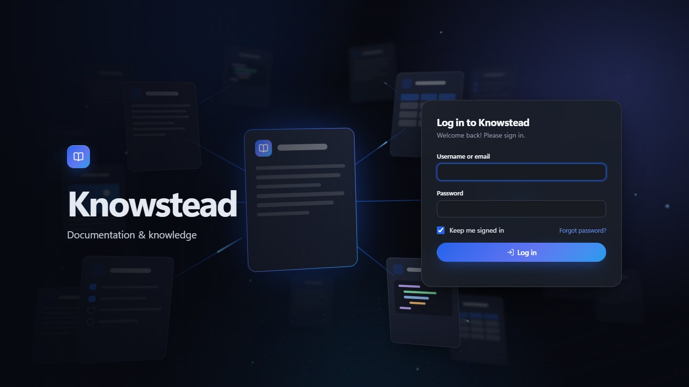
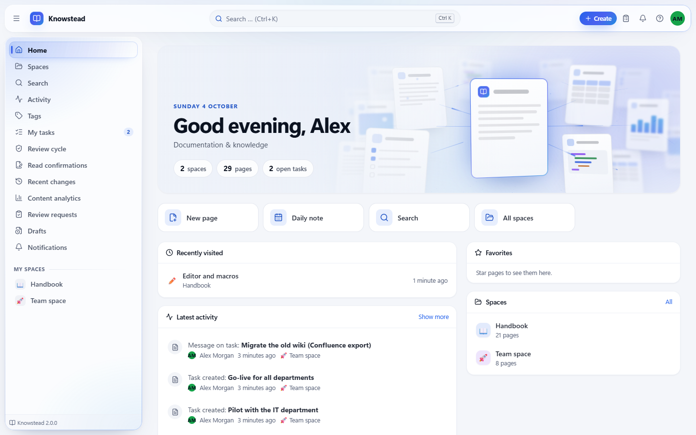
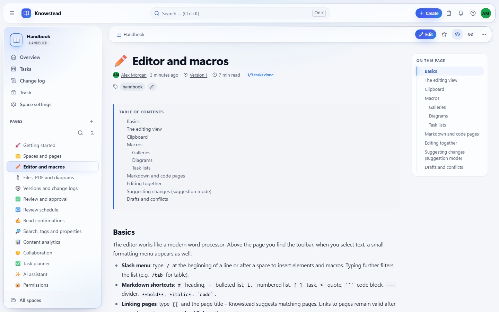
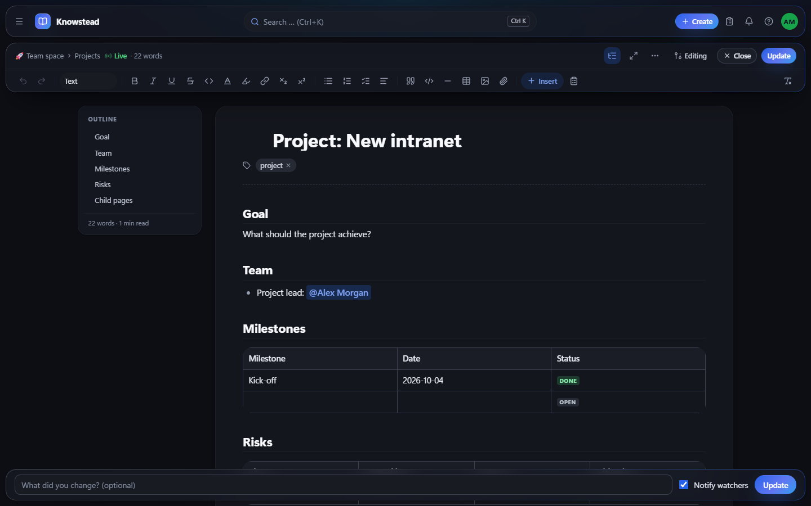
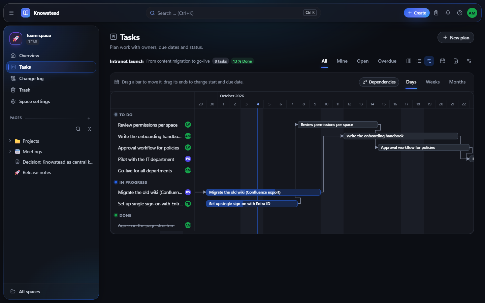
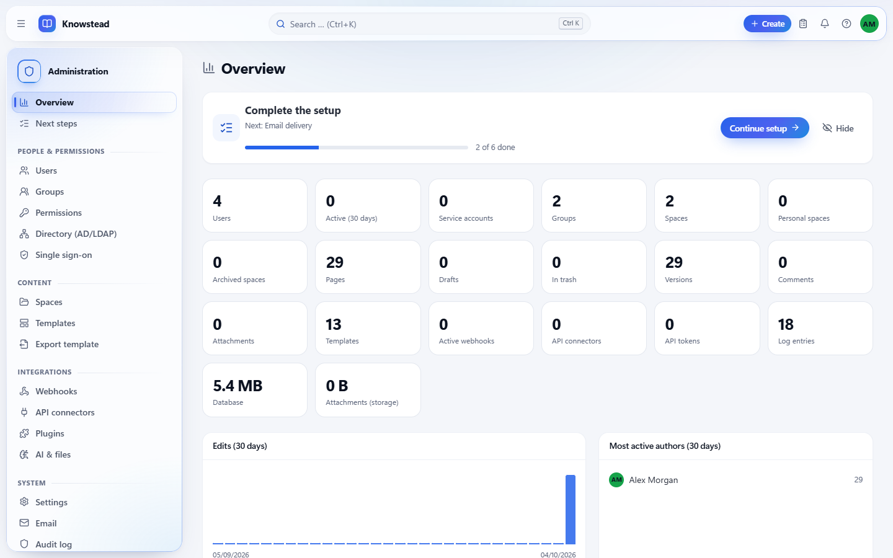

# Knowstead

**A self-hosted team wiki and knowledge base that runs as one process with one database file.**
Spaces and page trees, real-time editing, approvals, read confirmations, a task planner, single sign-on,
search inside attachments, AI assistance and PDF/Word export – built in, with no extra services to operate
and no per-user licence.

*[Deutsche Fassung](README.de.md)*



Knowstead is made for organisations that want to keep their documentation on their own network: IT
departments, quality management, engineering teams, public authorities, practices and associations.
It is installed with Node.js and stores everything in a single SQLite file – there is no database server,
no cache, no queue and no build toolchain on the server.

- **Everything in one place.** Wiki, editorial review, mandatory reading, task planning and file preview
  work together instead of being separate products or paid add-ons.
- **Content you can rely on.** Every page can have an owner and a review interval; approvals, read
  confirmations and content analytics show what is current, who has read it and what nobody looks at.
- **Easy to run.** A guided installer for Windows and Linux, nightly backups, one command to update with
  automatic rollback, and an administration area that tells you what is still missing.
- **Your data stays yours.** No telemetry, no cloud dependency. AI is optional, provider-neutral and can
  run locally (Ollama).

> **Status:** version 2.0 – developed by SteinTecDev, a very small team, used in production internally
> and published here for the first time. Read [Is Knowstead a good fit?](#is-knowstead-a-good-fit) –
> including what it does not do – before you rely on it.

---

## Contents

- [Screenshots](#screenshots)
- [Features](#features)
- [Is Knowstead a good fit?](#is-knowstead-a-good-fit)
- [Quick start](#quick-start)
- [Updating](#updating)
- [Configuration](#configuration)
- [Documentation](#documentation)
- [Languages](#languages)
- [Development](#development)
- [Technology](#technology)
- [Security, support and licence](#security-support-and-licence)

---

## Screenshots

| | |
| --- | --- |
|  **Home** – greeting, quick actions, recent pages and activity |  **Reading** – page tree, breadcrumbs, table of contents, tags |
|  **Editing** – rich-text editor with outline, live collaboration and change notes |  **Planning** – boards, lists and a timeline with dependencies |
|  **Administration** – everything is configured in the browser | |

Light and dark design are both shown; each user chooses their own.

---

## Features

| Area | What you get |
| --- | --- |
| **Content** | Spaces with a page tree, rich-text editor with macros (callouts, tabs, galleries, Mermaid, formulas, code), Markdown and code pages, templates, attachments, drafts, trash |
| **Editing together** | **Real-time collaboration** with visible cursors, **suggestion mode** (track changes with accept/reject), comments on pages and text passages, @-mentions, presence |
| **Quality and compliance** | Editorial review, **multi-stage approval workflows** with escalation and **absence deputies**, **read confirmations** with audience, deadline, reminders and an evidence list, **review schedule** with content owners, one-click undo of recent changes, audit log |
| **Finding things** | Full-text search with filters, **search inside attachments** (PDF, Office) with optional **OCR** for scans, tags, properties, backlinks, link map, journal, favourites |
| **Files** | PDF viewer, video and audio playback, preview of Word, Excel, PowerPoint and Visio files (with LibreOffice), **draw.io** diagrams and a **whiteboard** (Excalidraw) |
| **Planning** | **Task planner**: board, list and **timeline** with **dependencies**, lag and automatic rescheduling, assignees, checklists, a **chat per task**, recurring tasks, reminders, CSV export, **calendar subscription (ICS)** |
| **Content analytics** | Most read, never read, orphaned pages, broken links, searches without results – a work list for editors |
| **Sign-in and permissions** | Local accounts, **Active Directory/LDAP**, **Microsoft Entra ID / OpenID Connect**, **SAML 2.0**, Windows-integrated sign-in (Kerberos) through a reverse proxy; groups are mapped from the directory; permissions per space **and** per page |
| **AI (optional)** | Improve, shorten, translate, summarise, outline, derive tasks and tags, ask questions about a page – with Claude, OpenAI, Azure OpenAI or a local model via Ollama; per-group enablement, daily limits, audit |
| **Import and export** | **PDF and Word with a corporate template**, Markdown, HTML, ZIP archive per space; importers for **Confluence, MediaWiki, DokuWiki and XWiki** (hierarchy, files and version history), Markdown/HTML/ZIP |
| **Integration** | REST API with OpenAPI UI at `/api/docs` (272 operations), API tokens with scopes, signed webhooks, API connectors for live data, plugins with server and browser parts |
| **Operation** | Installer for Windows and Linux (systemd, also Proxmox LXC), Docker, nightly backups, **one-command update with automatic rollback**, e-mail alerts for administrators, health and monitoring endpoints, a built-in handbook |

The interface comes with light and dark design, keyboard shortcuts, a command palette (`Ctrl`+`K`), a
responsive layout for phones and tablets and is checked automatically against **WCAG 2.1 AA** on every
page. Quality assurance: 452 server tests, 298 browser tests and a layout sweep over every page in five
window widths.

---

## Is Knowstead a good fit?

**A good fit for** internal documentation, handbooks, processes and quality management in organisations
of up to a few hundred people, at one site, with someone who can look after a Windows or Linux server
(load-tested with 500 accounts, 10,000 pages and 100 people working at the same moment).

**Not a good fit for** setups that need high availability or several sites (it is a single server with
SQLite), mobile apps with offline use, an extension marketplace – or a vendor with a support contract.

What is deliberately *not* there yet: two-factor authentication for local accounts (use single sign-on),
AI questions across the whole knowledge base, database views over page properties.

---

## Quick start

Requirement: **[Node.js 24](https://nodejs.org/) or newer**. Nothing else.

### Try it on your own machine

```bash
git clone https://github.com/BStein-coder/Knowstead.git
cd Knowstead
npm install
npm run build
npm start
```

Open `http://localhost:3000` – the setup wizard creates the first administrator account. Choose
**English** there to get the handbook, templates and sample content in English.
On Windows a double-click on `start.cmd` does the same (Linux/macOS: `./start.sh`).

### Install on a server

Download the installation package for your operating system from the
[Releases](https://github.com/BStein-coder/Knowstead/releases) page (or build it yourself:
`npm run build && node scripts/package.mjs --target linux-x64`). The packages contain the built user
interface and all runtime dependencies – the server needs neither npm downloads nor a build.

| System | Steps |
| --- | --- |
| **Linux** (Debian, Ubuntu, RHEL family, also in a Proxmox LXC container) | `sudo tar -xzf knowstead-<version>-linux-x64.tar.gz -C /opt && sudo mv /opt/knowstead-<version>-linux-x64 /opt/knowstead` and then `cd /opt/knowstead && sudo bash install.sh` – creates the service account, data directory, configuration and a hardened systemd service; offers to install Node.js 24, Tesseract (OCR) and LibreOffice (Office preview) |
| **Windows** (Server 2019+ or Windows 10/11) | Extract the ZIP, double-click **`Knowstead-Installation.cmd`** – a graphical wizard for data directory, reverse proxy, automatic start (scheduled task or NSSM service), firewall and antivirus exclusion |
| **Docker** | `cp .env.example .env` (set `BASE_URL` and `KNOWSTEAD_SECRET`), then `docker compose up -d` |

Then put a reverse proxy with HTTPS in front (Caddy, nginx, IIS or Apache – ready-made configurations are
in the guide) and open the address in the browser. After the setup, **Administration → Next steps** walks
you through e-mail, backups, people and spaces.

- **[Quick start guide](docs/QUICKSTART.md)** – from download to a running, backed-up installation in
  about 15 minutes
- **[Installation guide](docs/INSTALLATION.en.md)** – the complete reference: Windows, Linux, Proxmox,
  Docker, HTTPS and reverse proxy, e-mail, Active Directory, single sign-on, OCR, backups, updates,
  troubleshooting

> The installers speak **English and German** – they follow the language of the system, or choose with
> `sudo bash install.sh --lang en` on Linux and `Knowstead-Installation.cmd -Language en` on Windows.
> `update.sh` and most command-line tools still print German messages; both guides give the exact commands.

---

## Updating

Updates never lose data: the server backs up the database before it changes it, all migrations run in one
transaction, and an older version refuses to start on a newer database.

On Linux one command does everything:

```bash
sudo bash /opt/knowstead/update.sh /tmp/knowstead-<version>-linux-x64.tar.gz
```

It verifies the checksum, puts the new program next to the old one, stops the service, swaps the folders,
starts and checks – and brings the previous version back (including the database) if the new one does not
answer. `sudo bash /opt/knowstead/update.sh --rollback` returns to the previous version later. On Windows,
stop Knowstead (`Knowstead-Dienst.cmd stop`), extract the new package over the program folder and run
`Knowstead-Installation.cmd -Unattended`; with Docker, `docker compose build --pull && docker compose up -d`.

---

## Configuration

Runtime parameters come from environment variables or a `.env` file (see [`.env.example`](.env.example)) –
the installer writes it for you:

| Variable | Default | Meaning |
| --- | --- | --- |
| `PORT` | `3000` | Server port |
| `HOST` | `0.0.0.0` | Network interface (`127.0.0.1` behind a local reverse proxy) |
| `BASE_URL` | `http://localhost:3000` | Public address (links in e-mails, webhooks, SSO redirect URIs) |
| `DATA_DIR` | `data` | Database, attachments, backups, server key – keep it outside the program folder |
| `KNOWSTEAD_SECRET` | generated | Key for encrypted credentials and signatures |
| `TRUST_PROXY` | `false` | Evaluate reverse-proxy headers: `true` or the proxy's addresses/networks |
| `COOKIE_SECURE` | `auto` | Session cookie over HTTPS only |
| `LOG_LEVEL` | `info` | Log level |

Everything else – site name, registration, password rules, SMTP, single sign-on, AI, backups, alerts – is
configured in the browser under **Administration**.

---

## Documentation

| Document | Content |
| --- | --- |
| [docs/QUICKSTART.md](docs/QUICKSTART.md) | Installation in short: Linux, Windows, Docker, HTTPS, first steps |
| [docs/INSTALLATION.en.md](docs/INSTALLATION.en.md) | Complete installation guide |
| [docs/handbook](docs/handbook/) | User and administration handbook (also built into every installation as the space "Handbook") |
| [SECURITY.md](SECURITY.md) | Security features and how to report a vulnerability |
| [CONTRIBUTING.md](CONTRIBUTING.md) | How to contribute (German) |
| [CHANGELOG.md](CHANGELOG.md) | Release notes (German) |
| [docs/API.md](docs/API.md) | REST API with examples (German) – the interactive OpenAPI reference at `/api/docs` is in every installation |
| [docs/ADMINISTRATION.md](docs/ADMINISTRATION.md) | Administration guide incl. Entra ID, SAML and Kerberos proxy examples (German) |
| [docs/PLUGINS.md](docs/PLUGINS.md), [docs/ARCHITEKTUR.md](docs/ARCHITEKTUR.md), [docs/ENTWICKLUNG.md](docs/ENTWICKLUNG.md) | Plugin development, architecture, development guide (German) |

German-speaking readers find everything in [README.de.md](README.de.md), [docs/INSTALLATION.md](docs/INSTALLATION.md)
and [docs/handbuch](docs/handbuch/).

---

## Languages

Knowstead was first built for German-speaking organisations and is bilingual:

- **English and German:** the complete web interface including administration, e-mails, exports, error
  messages, templates and the handbook. Each user chooses their language; the administrator sets the
  default. The installers (`install.sh`, the Windows wizard, the start scripts) and the installation check
  (`npm run cli -- doctor --lang en`) follow the system language or an explicit choice.
- **German only for now:** `update.sh`, the rest of the command-line tool, the server log and the release
  notes, plus the technical guides marked "(German)" above.

Source code comments and commit messages are in German; identifiers are in English.

---

## Development

```bash
npm run dev          # API on :3000 with restart, UI with hot reload on :5173
npm run lint         # ESLint and translation completeness
npm run typecheck    # TypeScript for server and UI
npm test             # server tests (node:test)
npm run test:e2e     # browser tests (Playwright, axe-core) – once: npm --prefix e2e ci
npm run test:sweep   # layout sweep: every page in five window widths
```

All UI texts live in `web/src/i18n/de.ts` and `en.ts`; server messages are translated via
`server/src/i18n/en.ts` (a test detects missing translations).

```
server/   API server (Fastify, TypeScript without a build step), SQLite access, migrations, tests
web/      user interface (React, Vite, TipTap)
e2e/      browser tests (Playwright, axe-core)
plugins/  example plugins
docs/     guides, handbook (handbook/ English, handbuch/ German)
scripts/  installer core, packaging, load test
```

---

## Technology

- **Server:** Node.js 24, Fastify 5, TypeScript executed directly (native type stripping, no build)
- **Database:** SQLite via `node:sqlite` (WAL), FTS5 full-text search, versioned migrations
- **UI:** React 19, Vite, TanStack Query, React Router, TipTap 3, Yjs, CodeMirror 6, Mermaid, KaTeX, pdf.js, Excalidraw
- **Sign-in:** ldapts, openid-client, @node-saml/node-saml
- **Optional:** LibreOffice (Office preview), Tesseract (OCR), draw.io (embedded or self-hosted), an AI provider of your choice
- **Security:** scrypt passwords, CSRF header check, token scopes, HTML sanitising, Content Security Policy, AES-256-GCM for stored credentials, rate limiting, PKCE/state/nonce for OIDC, signed SAML assertions

---

## Security, support and licence

- **Maintainer:** SteinTecDev – <info@steintecdev.com>
- **Vulnerabilities:** please report them privately – see [SECURITY.md](SECURITY.md).
- **Questions and bugs:** open an issue in this repository. There is no commercial support and no
  guaranteed response time.
- **Licence:** [MIT](LICENSE).

> Up to version 1.9 Knowstead was called "Doku". Existing installations keep running unchanged after the
> update – see the [release notes for 2.0.0](CHANGELOG.md) (German).
