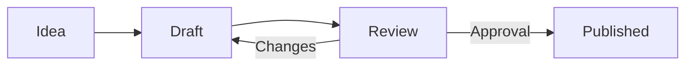

# Editor and macros

<!-- toc -->

## Basics

The editor works like a modern word processor. Above the page you find the toolbar; when you select text, a small formatting menu appears as well.

- **Slash menu**: type `/` at the beginning of a line or after a space to insert elements and macros. Typing further filters the list (e.g. `/tab` for table).
- **Markdown shortcuts**: `# ` heading, `- ` bulleted list, `1. ` numbered list, `[ ] ` task, `> ` quote, ` ``` ` code block, `---` divider, `**bold**`, `*italic*`, `` `code` ``.
- **Linking pages**: type `[[` and the page title – Knowstead suggests matching pages. Links to pages remain valid after renaming and appear as a **backlink** on the target page.
- **Mentioning people**: type `@` and a name. Mentioned people are notified.
- **Images and files**: via drag & drop, pasting from the clipboard or the slash menu. Files are stored as attachments of the page – PDFs appear as a viewer, other files as a card (see chapter **Files, PDF and diagrams**).

## The editing view

While editing, the page lies in the centre like a **sheet of paper** so you can concentrate on the content:

- **Header**: space, save status of the draft and word count; on the right **Outline**, **Full width**, **Close** and **Publish**.
- **Toolbar** below – stays visible while scrolling.
- **Outline** on the left: all headings (levels 1 to 3) with word count and reading time. A click jumps to the position. The icon in the header shows and hides the outline.
- **Tags** directly below the title: type, `Enter` – they are saved when publishing.
- **Footer**: change note and the choice whether watchers are notified.

## Clipboard

The **Knowstead clipboard** collects text snippets you will need again later – across pages and spaces and only visible to you:

- **Store from the view**: select text and choose **To clipboard** (formatting is preserved).
- **Store in the editor**: select text, open the **Clipboard** icon in the toolbar and choose **Store selection**.
- **Insert**: open the clipboard in the editor and choose **Insert** for the desired entry.
- **Store a link**: **… → Link to clipboard** on every page.

The last 50 entries are kept; **pinned** entries are never removed automatically. The clipboard is also available at the top right of the top bar.

## Macros

Macros are dynamic building blocks. In the editor you configure them via the gear icon and remove them with the trash icon.

| Macro | Description |
| --- | --- |
| **Callout** | Info, note, tip, warning or error – change the colour by clicking the icon |
| **Expand** | Content that is only expanded when needed |
| **Status** | Coloured label such as <span data-type="status" data-color="green">DONE</span> – click to change text and colour |
| **Table of contents** | Generated automatically from the headings |
| **Child pages** | List of child pages with adjustable depth and sorting |
| **Include page** | Shows the content of another page (single source of truth) |
| **Change history** | Table of versions with change notes – ideal at the end of policies |
| **Recently changed** | Latest changes in the space or system-wide, optionally by tag |
| **Gallery** | Image gallery with lightbox – grid, masonry or strip |
| **Attachments** | File list of the page |
| **Properties report** | Table from properties of the child pages (e.g. project status) |
| **API data** | Live data from a connected API as table, list or value |
| **Diagram** | Flow, sequence, Gantt and other diagrams with Mermaid |
| **Formula** | Mathematical formulas in LaTeX notation |
| **Embed** | YouTube, Figma, draw.io, Google Docs and other approved services |
| **Show PDF / Office** | PDF viewer in the page; Office and Visio files with a configured preview |
| **draw.io diagram** | Draw and edit diagrams directly in Knowstead |
| **Whiteboard** | Free sketches in hand-drawn style with Excalidraw – for ideas, workshops and quick drafts |
| **Tasks** | Tasks of a board from the task planner – open, all or only those of this page |

> [!TIP]
> Plugins can add further macros. They appear in the slash menu in the group "Plugins".

### Galleries

Several images belong in a **gallery** rather than one below the other:

1. Type `/gallery` in the editor and insert the macro.
2. Click **Add images**.
3. **Upload** images or choose them from the **page's attachments**.

In the dialog you can also set:

- **Columns** (2 to 6) and **layout**: grid (tiles of equal size), masonry (natural heights) or strip (scrollable sideways),
- **captions** per image,
- the **order** – by dragging or with the arrows.

When reading, clicking an image opens the large view (lightbox): browse with the arrows or the arrow keys, close with `Esc`.

> [!TIP]
> Uploaded images automatically end up in the page's attachments and can be reused from there.

### Diagrams

Diagrams are described as text and drawn automatically. An example:



### Task lists

- [x] Tasks can be ticked off in the editor and directly in the view
- [ ] Ticking off in the view creates a minor version ("Task completed")
- [ ] The number of open tasks appears in the page header

## Markdown and code pages

**Markdown pages** are edited with a source editor and live preview. GitHub callouts (`> [!NOTE]`), task lists, tables and Mermaid diagrams are supported.

**Code pages** are suitable for configurations and scripts. Choose the language for syntax highlighting; the view shows line numbers and a copy button.

## Editing together

Several people can edit document pages (rich text) **at the same time**. The editor header then shows **Live**:

- Changes appear immediately for everyone currently editing the page – **coloured cursors with names** show who is writing where.
- Title, icon, tags and page width are shared as well.
- The shared state is **saved continuously**. You can close the editor, reload or continue later – nothing is lost.
- **Publish** creates a new version with all changes as usual. Everyone involved sees who published and continues working on the new state.
- In the page view a notice shows who is currently editing and whether there are **unpublished changes**.

> [!NOTE]
> If the page was changed in another way in the meantime (e.g. an older version was restored), the editor points this out. You can then **discard** the shared state and load the published version – or deliberately publish over it; the other version remains in the history.

If live collaboration cannot be reached (for example because of a network setting), the editor reports this and you edit with your personal draft as before.

## Suggesting changes (suggestion mode)

For policies or agreed texts, others should not simply rewrite but **suggest changes** that the author decides on – like "Track changes" in Word.

**Setting the mode**: in the page's **"…"** menu under **Editing mode …** the author, the owner or the space administrators choose:

| Mode | Effect |
| --- | --- |
| **Edit directly** | whoever may edit changes the text directly |
| **Suggestions only** | changes by other people become suggestions |

The space administrators can additionally **lock** the mode – then only they can change it again. For new pages of a space they set the default in the **space settings** ("Editing mode of new pages").

**Suggesting**: in the editor, the **Suggest | Edit** button in the header switches the mode – with "Suggestions only" it is fixed to *Suggest*. Inserted text then appears underlined in green, deleted text struck through in red, each with name and time. Formatting and blocks cannot be changed in suggestion mode.

**Deciding**: the **Suggested changes** panel lists all open suggestions. The author, owner and space administrators can **accept** or **reject** each suggestion – or **Accept all** or **Reject all**. Your own suggestions can be **withdrawn**. Save with **Update**.

> [!NOTE]
> Readers only see suggestions once they are accepted: page view, search and exports always show the text without open suggestions. In the page header a notice "3 suggestions" tells everyone with edit permission that something is pending.

Suggestions also work while editing together in real time.

## Drafts and conflicts

Without live collaboration – for Markdown and code pages or when it is turned off – Knowstead saves a **draft** every few seconds while you write, visible only to you. When you open the editor again later, Knowstead offers to restore the draft.

If two people then edit the same page at the same time, Knowstead shows a notice at the top ("… is currently editing this page"). If someone has published in the meantime, Knowstead detects the **conflict** when publishing and you can choose: overwrite, reload or copy your version to the clipboard.
