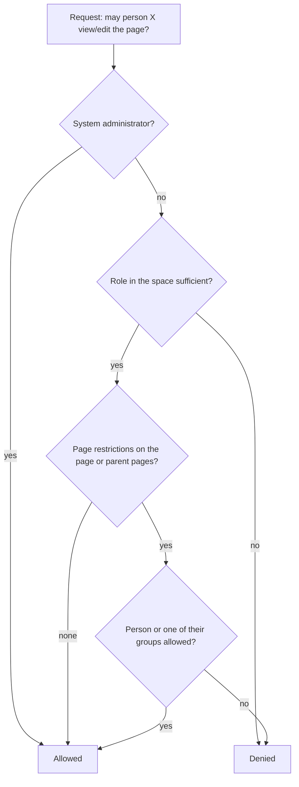

# Permissions

Knowstead combines three levels. Together they form a finely controllable yet easy-to-understand permission system.

<!-- toc -->

## Overview

## 1. Global permissions

Global permissions are assigned to **groups** (Administration → Groups or Permissions):

| Permission | Allows |
| --- | --- |
| System administration | Everything – including all spaces and settings |
| Create spaces | Create new team spaces |
| Manage users & groups | Create and lock accounts, maintain groups (only administrators change administrator accounts) |
| Manage global templates | Maintain system-wide templates |
| Manage integrations | Set up webhooks and API connectors |
| View audit log | Read security and administration events |
| View content analytics | Content analytics for all readable spaces, including searches without results |
| Create API tokens | Personal access tokens for the REST API |
| Use AI features | AI assistant in the editor and on pages (if the AI is set up) |

The group **Benutzer** (users) is the default group: new accounts become members automatically.

## 2. Roles in the space

Every space assigns roles to users, groups, **all signed-in users** or **anonymous visitors** (read only, if allowed in the system settings). The highest applicable role applies.

| Action | Read | Comment | Edit | Manage |
| --- | :---: | :---: | :---: | :---: |
| Read and export pages | ✓ | ✓ | ✓ | ✓ |
| Comment | | ✓ | ✓ | ✓ |
| Create, edit, move, delete pages | | | ✓ | ✓ |
| Upload attachments, restrict pages | | | ✓ | ✓ |
| Moderate comments, permanently empty trash | | | | ✓ |
| Request read confirmations, content analytics of the space | | | | ✓ |
| Space settings and permissions | | | | ✓ |

> [!NOTE]
> In **archived** spaces only reading, exporting and managing remain possible.

## 3. Restrictions per page

Via **… → Restrictions** (lock icon) you define:

- **Who may view the page?** – also applies to **all child pages**. Restricted pages appear for others neither in the page tree nor in search, activity or notifications.
- **Who may edit the page?** – only applies to the page itself.

When setting a restriction you always remain permitted yourself so you do not lock yourself out. Space administrators see all restrictions at a glance under **Space settings → Restricted pages**.

## Signing in via Active Directory

If directory sign-in is set up (Administration → Directory), you sign in with your usual Windows account – username (or `name@company.local`) and your domain password.

The following applies:

- Your account is created automatically on first sign-in, if allowed.
- Your **AD security groups** are synchronised with the Knowstead groups: permissions come and go with group membership in the directory.
- Passwords from the directory are never stored in Knowstead; you change your password in Windows as usual.

Administrators map the groups under **Administration → Groups** (field "Directory and SSO groups").

## Signing in with your company account (single sign-on)

If the administrators have set up single sign-on, the sign-in page shows additional buttons:

| Button (example) | Sign-in |
| --- | --- |
| **Sign in with Microsoft** | via Microsoft Entra ID (formerly Azure AD) or another OpenID Connect provider |
| **Sign in with company account (SAML)** | via a SAML provider such as ADFS or Shibboleth |
| **Sign in with Windows account** | without entering a password, with the Windows account signed in on the corporate network (Kerberos) |

As with Active Directory: the account is created on first sign-in (if allowed), and the **groups** from Entra ID or the SAML provider are synchronised with the Knowstead groups.

**Linking your account**: under **Profile → Sign-in** you connect your existing Knowstead account with your company account – afterwards you sign in either with your password or via single sign-on. There you also see all linked accounts and can **unlink** them. The last sign-in method of an account cannot be unlinked.

> [!NOTE]
> For security reasons, administrator accounts are never linked to a company account automatically. Administrators sign in locally once and link their account in the profile.

## API tokens

Tokens act with the permissions of their user and are additionally limited by **scopes**:

| Scope | Allows |
| --- | --- |
| `read` | Only reading requests (GET) |
| `write` | Additionally changes (POST, PUT, PATCH, DELETE) |
| `admin` | Additionally `/api/v1/admin/…` (administrators only) |

For integrations a **service account** (Administration → Users → "Service account") with exactly the space roles the integration needs is recommended.
