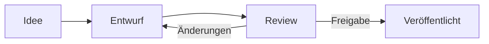

# Editor und Makros

<!-- toc -->

## Grundlagen

Der Editor arbeitet wie ein modernes Textverarbeitungsprogramm. Über der Seite findest du die Werkzeugleiste, beim Markieren von Text erscheint zusätzlich ein kleines Formatierungsmenü.

- **Slash-Menü**: Tippe `/` am Zeilenanfang oder nach einem Leerzeichen, um Elemente und Makros einzufügen. Weitertippen filtert die Liste (z. B. `/tab` für Tabelle).
- **Markdown-Kürzel**: `# ` Überschrift, `- ` Aufzählung, `1. ` nummerierte Liste, `[ ] ` Aufgabe, `> ` Zitat, ` ``` ` Codeblock, `---` Trennlinie, `**fett**`, `*kursiv*`, `` `code` ``.
- **Seiten verlinken**: Tippe `[[` und den Seitentitel – Knowstead schlägt passende Seiten vor. Links auf Seiten bleiben auch nach Umbenennen gültig und erscheinen als **Rückverweis** auf der Zielseite.
- **Personen erwähnen**: Tippe `@` und einen Namen. Erwähnte Personen werden benachrichtigt.
- **Bilder und Dateien**: per Drag & Drop, Einfügen aus der Zwischenablage oder über das Slash-Menü. Dateien werden als Anhang der Seite gespeichert – PDFs erscheinen als Betrachter, andere Dateien als Karte (siehe Kapitel **Dateien, PDF und Diagramme**).

## Die Bearbeitungsansicht

Beim Bearbeiten liegt die Seite wie ein **Blatt Papier** in der Mitte, damit du dich auf den Inhalt konzentrieren kannst:

- **Kopfzeile**: Bereich, Speicherstatus des Entwurfs und Wortanzahl, rechts **Gliederung**, **Volle Breite**, **Schließen** und **Veröffentlichen**.
- **Werkzeugleiste** darunter – bleibt beim Scrollen sichtbar.
- **Gliederung** links: alle Überschriften (Ebene 1 bis 3) mit Wortanzahl und Lesezeit. Ein Klick springt zur Stelle. Das Symbol in der Kopfzeile blendet die Gliederung ein und aus.
- **Stichwörter** direkt unter dem Titel: tippen, `Enter` – sie werden beim Veröffentlichen gespeichert.
- **Fußzeile**: Änderungsnotiz und die Wahl, ob Beobachter benachrichtigt werden.

## Zwischenablage

Die **Knowstead-Zwischenablage** sammelt Textbausteine, die du später wieder brauchst – über Seiten und Bereiche hinweg und nur für dich sichtbar:

- **Ablegen in der Ansicht**: Text markieren und **In Zwischenablage** wählen (Formatierung bleibt erhalten).
- **Ablegen im Editor**: Text markieren, Symbol **Zwischenablage** in der Werkzeugleiste öffnen und **Markierung ablegen** wählen.
- **Einfügen**: im Editor die Zwischenablage öffnen und beim gewünschten Eintrag **Einfügen** wählen.
- **Link ablegen**: **… → Link in Zwischenablage** auf jeder Seite.

Die letzten 50 Einträge bleiben erhalten; **angeheftete** Einträge werden nie automatisch entfernt. Die Zwischenablage erreichst du auch oben rechts in der Kopfzeile.

## Makros

Makros sind dynamische Bausteine. Im Editor kannst du sie über das Zahnrad-Symbol konfigurieren und mit dem Papierkorb-Symbol entfernen.

| Makro | Beschreibung |
| --- | --- |
| **Hinweisbox** | Info, Notiz, Tipp, Warnung oder Fehler – Farbe per Klick auf das Symbol wechseln |
| **Aufklappbereich** | Inhalte, die erst bei Bedarf aufgeklappt werden |
| **Status** | Farbiges Etikett wie <span data-type="status" data-color="green">ERLEDIGT</span> – Text und Farbe per Klick ändern |
| **Inhaltsverzeichnis** | Wird automatisch aus den Überschriften erzeugt |
| **Unterseiten** | Liste der Unterseiten mit einstellbarer Tiefe und Sortierung |
| **Seite einbinden** | Zeigt den Inhalt einer anderen Seite an (Single Source of Truth) |
| **Änderungshistorie** | Tabelle der Versionen mit Änderungsnotizen – ideal am Ende von Richtlinien |
| **Zuletzt geändert** | Neueste Änderungen im Bereich oder systemweit, optional nach Stichwort |
| **Galerie** | Bildergalerie mit Lightbox – Raster, Mauerwerk oder Streifen |
| **Anhänge** | Dateiliste der Seite |
| **Eigenschaften-Bericht** | Tabelle aus Eigenschaften der Unterseiten (z. B. Projektstatus) |
| **API-Daten** | Live-Daten aus einer angebundenen API als Tabelle, Liste oder Wert |
| **Diagramm** | Fluss-, Sequenz-, Gantt- und weitere Diagramme mit Mermaid |
| **Formel** | Mathematische Formeln in LaTeX-Schreibweise |
| **Einbettung** | YouTube, Figma, draw.io, Google Docs und weitere freigegebene Dienste |
| **PDF / Office anzeigen** | PDF-Betrachter im Beitrag; Office- und Visio-Dateien mit eingerichteter Vorschau |
| **draw.io-Diagramm** | Diagramme direkt in Knowstead zeichnen und bearbeiten |
| **Whiteboard** | Freie Skizzen im Handzeichnungs-Stil mit Excalidraw – für Ideen, Workshops und schnelle Entwürfe |
| **Aufgaben** | Aufgaben eines Plans aus dem Aufgabenplaner – offen, alle oder nur die dieser Seite |

> [!TIP]
> Plugins können weitere Makros hinzufügen. Sie erscheinen im Slash-Menü in der Gruppe „Plugins“.

### Galerien

Mehrere Bilder gehören in eine **Galerie** statt einzeln untereinander:

1. Im Editor `/galerie` tippen und das Makro einfügen.
2. Auf **Bilder hinzufügen** klicken.
3. Bilder **hochladen** oder aus den **Anhängen der Seite** auswählen.

Im Dialog lassen sich außerdem einstellen:

- **Spalten** (2 bis 6) und **Darstellung**: Raster (gleich große Kacheln), Mauerwerk (natürliche
  Höhen) oder Streifen (seitlich scrollbar),
- **Bildunterschriften** je Bild,
- die **Reihenfolge** – per Ziehen oder mit den Pfeilen.

Beim Lesen öffnet ein Klick auf ein Bild die Großansicht (Lightbox): weiterblättern mit den Pfeilen
oder den Pfeiltasten, schließen mit `Esc`.

> [!TIP]
> Hochgeladene Bilder landen automatisch bei den Anhängen der Seite und lassen sich dort auch
> wiederverwenden.

### Diagramme

Diagramme werden als Text beschrieben und automatisch gezeichnet. Ein Beispiel:



### Aufgabenlisten

- [x] Aufgaben lassen sich im Editor und direkt in der Ansicht abhaken
- [ ] Das Abhaken in der Ansicht erzeugt eine kleine Version („Aufgabe erledigt“)
- [ ] Die Anzahl offener Aufgaben erscheint im Seitenkopf

## Markdown- und Code-Seiten

**Markdown-Seiten** werden mit einem Quelltext-Editor und Live-Vorschau bearbeitet. GitHub-Hinweise (`> [!NOTE]`), Aufgabenlisten, Tabellen und Mermaid-Diagramme werden unterstützt.

**Code-Seiten** eignen sich für Konfigurationen und Skripte. Wähle die Sprache für die Syntaxhervorhebung; die Ansicht zeigt Zeilennummern und einen Kopieren-Knopf.

## Gemeinsam bearbeiten

Dokument-Seiten (Rich-Text) können mehrere Personen **gleichzeitig** bearbeiten. In der Kopfzeile des Editors steht dann **Live**:

- Änderungen erscheinen sofort bei allen, die die Seite gerade bearbeiten – **farbige Cursor mit Namen** zeigen, wer wo schreibt.
- Auch Titel, Symbol, Stichwörter und die Seitenbreite werden geteilt.
- Der gemeinsame Stand wird **laufend gespeichert**. Du kannst den Editor schließen, neu laden oder später weitermachen – nichts geht verloren.
- **Veröffentlichen** erzeugt wie gewohnt eine neue Version mit allen Änderungen. Alle Beteiligten sehen, wer veröffentlicht hat, und arbeiten auf dem neuen Stand weiter.
- In der Seitenansicht zeigt ein Hinweis, wer gerade bearbeitet und ob es **unveröffentlichte Änderungen** gibt.

> [!NOTE]
> Wurde die Seite zwischendurch auf anderem Weg geändert (z. B. eine ältere Version wiederhergestellt), weist der Editor darauf hin. Dann kannst du den gemeinsamen Stand **verwerfen** und die veröffentlichte Fassung laden – oder bewusst darüber veröffentlichen; die andere Fassung bleibt in den Versionen erhalten.

Ist die gemeinsame Bearbeitung nicht erreichbar (etwa wegen einer Netzwerk-Einstellung), meldet der Editor das und du bearbeitest wie bisher mit deinem persönlichen Entwurf.

## Änderungen vorschlagen (Vorschlagsmodus)

Bei Richtlinien oder abgestimmten Texten sollen andere nicht einfach umschreiben, sondern
**Änderungen vorschlagen**, über die die Autorin oder der Autor entscheidet – wie „Änderungen
nachverfolgen“ in Word.

**Modus festlegen**: Im Menü **„…“** der Seite unter **Bearbeitungsmodus …** wählen Autorin bzw.
Autor, die verantwortliche Person oder die Bereichsverwaltung:

| Modus | Wirkung |
| --- | --- |
| **Direkt bearbeiten** | wer bearbeiten darf, ändert den Text direkt |
| **Nur Vorschläge** | Änderungen anderer Personen werden zu Vorschlägen |

Die Bereichsverwaltung kann den Modus zusätzlich **festschreiben** – dann kann nur sie ihn wieder ändern.
Für neue Seiten eines Bereichs legt sie die Vorgabe in den **Bereichseinstellungen** fest
(„Bearbeitungsmodus neuer Seiten“).

**Vorschlagen**: Im Editor schaltet der Knopf **Vorschlagen | Bearbeiten** in der Kopfleiste um – bei
„Nur Vorschläge“ ist er fest auf *Vorschlagen*. Eingefügter Text erscheint dann grün unterstrichen,
gelöschter Text rot durchgestrichen, jeweils mit Name und Zeitpunkt. Formatierungen und Blöcke lassen
sich im Vorschlagsmodus nicht ändern.

**Entscheiden**: Die Leiste **Änderungsvorschläge** listet alle offenen Vorschläge. Autorin bzw. Autor,
verantwortliche Person und Bereichsverwaltung können jeden Vorschlag **annehmen** oder **ablehnen** –
oder **Alle annehmen** bzw. **Alle ablehnen**. Eigene Vorschläge lassen sich **zurückziehen**.
Gespeichert wird mit **Aktualisieren**.

> [!NOTE]
> Lesende sehen Vorschläge erst, wenn sie angenommen sind: Seitenansicht, Suche und Exporte zeigen
> immer den Text ohne offene Vorschläge. Im Seitenkopf zeigt ein Hinweis „3 Vorschläge“ allen mit
> Bearbeitungsrecht, dass etwas ansteht.

Vorschläge funktionieren auch beim gemeinsamen Bearbeiten in Echtzeit.

## Entwürfe und Konflikte

Ohne gemeinsame Bearbeitung – bei Markdown- und Code-Seiten oder wenn sie ausgeschaltet ist – speichert Knowstead während des Schreibens alle paar Sekunden einen **Entwurf**, nur für dich sichtbar. Wenn du den Editor später wieder öffnest, bietet Knowstead an, den Entwurf wiederherzustellen.

Bearbeiten dann zwei Personen gleichzeitig dieselbe Seite, zeigt Knowstead oben einen Hinweis („… bearbeitet diese Seite gerade“). Hat jemand zwischenzeitlich veröffentlicht, erkennt Knowstead den **Konflikt** beim Veröffentlichen und du kannst wählen: überschreiben, neu laden oder deine Version in die Zwischenablage kopieren.
