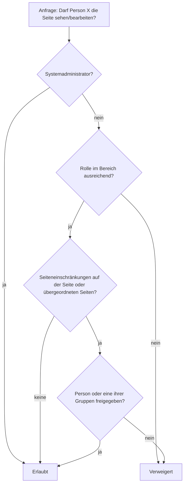

# Berechtigungen

Knowstead kombiniert drei Ebenen. Zusammen ergeben sie ein fein steuerbares und trotzdem leicht verständliches Rechtesystem.

<!-- toc -->

## Überblick

## 1. Globale Rechte

Globale Rechte werden **Gruppen** zugewiesen (Administration → Gruppen bzw. Berechtigungen):

| Recht | Erlaubt |
| --- | --- |
| Systemadministration | Alles – inkl. aller Bereiche und Einstellungen |
| Bereiche erstellen | Neue Team-Bereiche anlegen |
| Benutzer & Gruppen verwalten | Konten anlegen, sperren, Gruppen pflegen (Administratorkonten ändern nur Administratoren) |
| Globale Vorlagen verwalten | Systemweite Vorlagen pflegen |
| Integrationen verwalten | Webhooks und API-Konnektoren einrichten |
| Audit-Log einsehen | Sicherheits- und Verwaltungsereignisse lesen |
| Inhaltsanalyse einsehen | Inhaltsanalyse aller lesbaren Bereiche inklusive Suchbegriffe ohne Treffer |
| API-Tokens erstellen | Persönliche Zugriffstokens für die REST-API |
| KI-Funktionen nutzen | KI-Assistent im Editor und auf Seiten (sofern die KI eingerichtet ist) |

Die Gruppe **Benutzer** ist Standardgruppe: Neue Konten werden automatisch Mitglied.

## 2. Rollen im Bereich

Jeder Bereich vergibt Rollen an Benutzer, Gruppen, **alle angemeldeten Benutzer** oder **anonyme Besucher** (nur Lesen, falls in den Systemeinstellungen erlaubt). Die höchste zutreffende Rolle gilt.

| Aktion | Lesen | Kommentieren | Bearbeiten | Verwalten |
| --- | :---: | :---: | :---: | :---: |
| Seiten lesen und exportieren | ✓ | ✓ | ✓ | ✓ |
| Kommentieren | | ✓ | ✓ | ✓ |
| Seiten erstellen, bearbeiten, verschieben, löschen | | | ✓ | ✓ |
| Anhänge hochladen, Seiten einschränken | | | ✓ | ✓ |
| Kommentare moderieren, Papierkorb endgültig leeren | | | | ✓ |
| Lesebestätigungen anfordern, Inhaltsanalyse des Bereichs | | | | ✓ |
| Bereichseinstellungen und Berechtigungen | | | | ✓ |

> [!NOTE]
> In **archivierten** Bereichen ist nur noch Lesen, Exportieren und Verwalten möglich.

## 3. Einschränkungen je Seite

Über **… → Einschränkungen** (Schloss-Symbol) legst du fest:

- **Wer darf die Seite sehen?** – gilt auch für **alle Unterseiten**. Eingeschränkte Seiten erscheinen für andere weder im Seitenbaum noch in Suche, Aktivität oder Benachrichtigungen.
- **Wer darf die Seite bearbeiten?** – gilt nur für die Seite selbst.

Beim Setzen einer Einschränkung bleibst du immer selbst berechtigt, damit du dich nicht aussperrst. Bereichsverwalter sehen unter **Bereichseinstellungen → Eingeschränkte Seiten** alle Einschränkungen im Überblick.

## Anmeldung über Active Directory

Ist die Verzeichnisanmeldung eingerichtet (Administration → Verzeichnis), meldest du dich mit deinem
gewohnten Windows-Konto an – Benutzername (oder `name@firma.local`) und dein Domänenpasswort.

Dabei gilt:

- Dein Konto wird beim ersten Anmelden automatisch angelegt, sofern erlaubt.
- Deine **AD-Sicherheitsgruppen** werden mit den Knowstead-Gruppen abgeglichen: Rechte kommen und gehen
  also mit der Gruppenmitgliedschaft im Verzeichnis.
- Passwörter aus dem Verzeichnis werden nie in Knowstead gespeichert; Passwortwechsel machst du wie
  gewohnt in Windows.

Administratoren ordnen die Gruppen unter **Administration → Gruppen** zu (Feld
„Verzeichnis- und SSO-Gruppen“).

## Anmeldung mit Firmenkonto (Single Sign-on)

Hat die Administration Single Sign-on eingerichtet, zeigt die Anmeldeseite zusätzliche Knöpfe:

| Knopf (Beispiel) | Anmeldung |
| --- | --- |
| **Mit Microsoft anmelden** | über Microsoft Entra ID (früher Azure AD) oder einen anderen OpenID-Connect-Anbieter |
| **Mit Firmenkonto anmelden (SAML)** | über einen SAML-Anbieter wie ADFS oder Shibboleth |
| **Mit Windows-Konto anmelden** | ohne Passworteingabe mit dem angemeldeten Windows-Konto im Firmennetz (Kerberos) |

Wie beim Active Directory gilt: Das Konto wird beim ersten Anmelden angelegt (sofern erlaubt), und die
**Gruppen** aus Entra ID bzw. dem SAML-Anbieter werden mit den Knowstead-Gruppen abgeglichen.

**Konto verknüpfen**: Unter **Profil → Anmeldung** verbindest du dein bestehendes Knowstead-Konto mit dem
Firmenkonto – danach meldest du dich wahlweise mit Passwort oder per Single Sign-on an. Dort siehst
du auch alle verknüpften Konten und kannst Verknüpfungen **trennen**. Die letzte Anmeldemöglichkeit
eines Kontos lässt sich nicht trennen.

> [!NOTE]
> Administratorkonten werden aus Sicherheitsgründen nie automatisch mit einem Firmenkonto verknüpft.
> Administratorinnen und Administratoren melden sich einmal lokal an und verknüpfen ihr Konto im Profil.

## API-Tokens

Tokens handeln mit den Rechten ihres Benutzers und werden zusätzlich durch **Umfänge** begrenzt:

| Umfang | Erlaubt |
| --- | --- |
| `read` | Nur lesende Anfragen (GET) |
| `write` | Zusätzlich Änderungen (POST, PUT, PATCH, DELETE) |
| `admin` | Zusätzlich `/api/v1/admin/…` (nur für Administratoren) |

Für Integrationen empfiehlt sich ein **Dienstkonto** (Administration → Benutzer → „Dienstkonto“) mit genau den Bereichsrollen, die die Integration benötigt.
